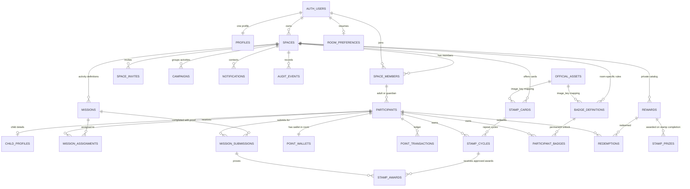

# Point+ v3 — ERD and key/ownership contract

The user-visible word **Room** means the existing table `public.spaces`.
No second `rooms` table is created. The same `space_id` must be
carried throughout each mission, stamp, badge, redemption and wallet.

## Primary keys and important constraints

- `spaces(id)` is the historical Room key. Preserve `spaces(id,kind)` unique and owner immutable.
- `space_members(space_id,user_id)` is the membership PK. Each Room holds many users; a user belongs to many Rooms.
- `participants(space_id,id)` supports scoped FKs to missions, wallets, redemptions and cycles. Child `user_id IS NULL` and guardian is a member in that same Room.
- `room_preferences(user_id)` has a nullable composite FK `(last_space_id,user_id) -> space_members(space_id,user_id)`; losing Room membership clears the pointer, not the account.
- `missions(space_id,id)` and `mission_submissions(space_id,id)` remain the authoritative unit of work. `mission_submissions(created_by,idempotency_key)` unique protects resubmission.
- `point_transactions(participant_id,source_type,source_id)` unique, `point_wallets(participant_id)` PK and `balance >= 0`.
- `stamp_cycles(participant_id,stamp_card_id,cycle_no)` unique. `stamp_awards(stamp_cycle_id,submission_id)` unique per award in a cycle; large quantities can span cycles by original v2 design.
- `participant_badges(participant_id,badge_id)` unique; v3 trigger enforces badge definition's Room equals the recipient's Room unless badge is legacy global.
- `redemptions(requested_by,idempotency_key)` unique and `stamp_prizes(stamp_cycle_id)` unique.
- `official_assets(asset_id)` is the **private canonical asset ID**, mapping to `stamp_cards.image_key` and `badge_definitions.image_key`. These mappings are *optional* for custom legacy items and intentionally not universal FKs.
- v3 protects immutable official asset rule fields against ordinary manager edits; private catalog and source asset identities are never exposed for user mutation.
- `notifications` must be filtered to recipient, not just any user sharing a Room. `audit_events` remains manager-only; avoid storing private evidence contents in audit payloads.

## R06 collections (six stamps and four badges per mode)

| Asset mode | v3 room type | Per-Room additions |
|---|---|---|
| couple | couple | 6 official cards + 4 official badge definitions |
| family | family | 6 official cards + 4 official badge definitions |
| personal | group, legacy personal | 6 official cards + 4 official badge definitions |

The art remains in `public/point-plus/{stamps,badges}` while earning and
unlocking are determined only by verified `stamp_awards`,
`stamp_cycles`, and `participant_badges` rows.

## Deployment dependency

The ERD documents the intended model from **v2 source** and v3 SQL proposal,
not an inspected remote database. Verify the live target and run all required
RLS/multi-account tests before approving the migration.
